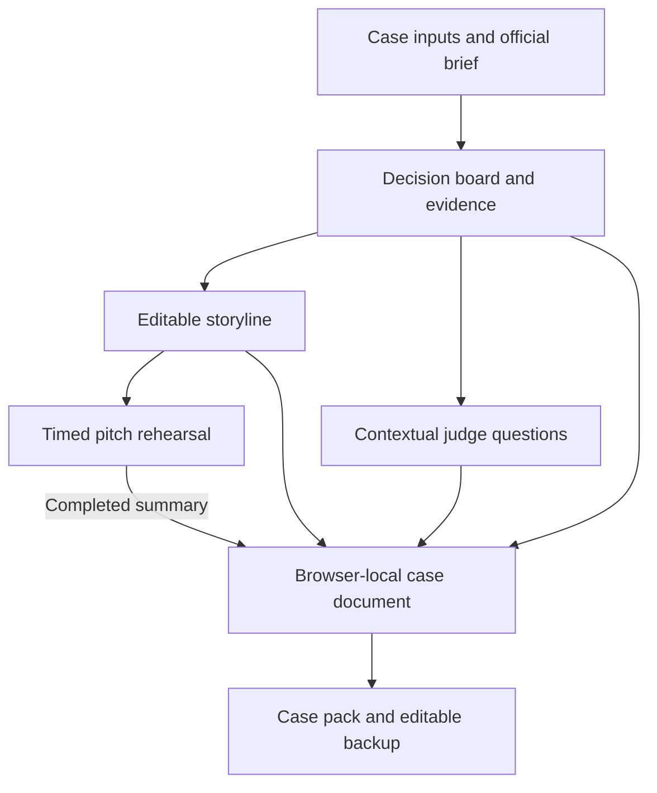
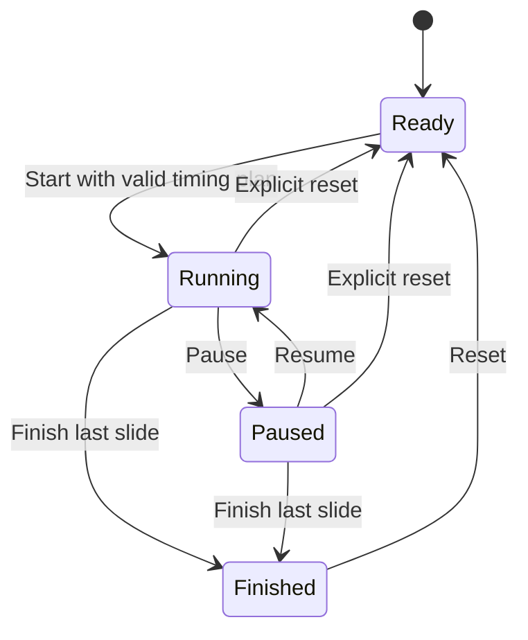

# Case Room Competition Workspace - Plan

## Goal Capsule

**Objective:** A case-competition team can arrive at a defensible recommendation, turn it into a presentation storyline, and rehearse the pitch and judges' questions in one website.

**Means:** A connected browser workspace with a decision board, editable six-slide outline, rehearsal timer, and contextual question cards (KTD1–KTD4).

**Delivery:** Submit this reviewed plan before 4 pm IST on 17 October 2026. Aim for a functional, tested, deployed MVP by 7 pm IST that day. The delivery window is a target, not a claim that testing or deployment has already passed.

**Authority:** The user's case-competition direction and explicit request for all three workflows govern scope. The implementing agent owns implementation, verification, source packaging, and the deployment handoff. User decisions in the Product Contract outrank implementation preferences.

**Stop conditions:** Report a material hosting or environment blocker. Keep the working local deliverable and its source. Never describe an untested flow, simulated AI capability, or private deployment as a verified public launch.

---

## Product Contract

### Summary

Case Room helps PGP/MBA case teams connect the recommendation they choose, the story they tell, and the answers they give judges. Its distinguishing feature is a visible critical assumption that carries through all three stages. A team can challenge that assumption without rebuilding its preparation in three separate documents.

### Problem Frame

The working hypothesis is that teams can assemble slides while leaving the underlying trade-offs and assumptions unresolved. A shared preparation artifact may expose those gaps before the final rehearsal. This is a product hypothesis, not validated demand. The first audience is the founder's PGP cohort and consulting or strategy clubs, where actual competition teams are reachable.

### Key Decisions

- D1. Cover recommendation, storyline, and rehearsal/Q&A together (session-settled: user-directed — chosen over selecting only one of the three workflows: the user answered “all 3 parts”). Governs R2–R9.
- D2. Focus on case competitions rather than the earlier investment-pitch idea. The user explicitly redirected the product. Governs R1–R10.

### Requirements

**Case and recommendation**

- R1. A visitor can open a clearly fictional India business case or start a blank case. Case name, team, decision statement, goal, constraints, and official must-answer requirements are editable.
- R2. The team can compare three named alternatives against four editable criteria. Each criterion has a weight from 0–100%; weights must total 100%. Every score must be between 1 and 5. Incomplete or invalid matrices withhold rankings. Equal weighted totals appear as ties.
- R3. A valid matrix shows weighted scores out of five and a sensitivity check: increase each eligible criterion by ten percentage points, capped at 100%, while scaling the other weights proportionally. Explain that scores and weights are team judgments. Never declare an objectively correct recommendation.
- R4. The team explicitly selects its recommendation and writes its rationale, critical assumption, economics, strongest objection, response, and implementation steps. Preserve its choice when matrix inputs change. Flag a difference between that choice and the matrix leaders as a discussion prompt.
- R5. Three evidence cards accept a claim, source title, HTTP/HTTPS link, source date, and page/slide reference. Clearly distinguish user-supplied sources from assumptions. The website records links without fetching or verifying them.

**Storyline**

- R6. Generate a six-slide outline from entered case content: recommendation, problem, alternatives, evidence/economics, implementation, and risk/ask. Each card has an editable headline, speaking points, duration, and essential/optional flag. Missing inputs remain visible prompts; generation invents no research or numbers.
- R7. Preserve custom outline edits when decision inputs change. Show a stale-outline notice and require an explicit regeneration action before replacing those edits. Show the current critical assumption separately on the risk slide and in rehearsal/Q&A so that it remains consistent without rewriting the team's prose.

**Practice**

- R8. A pitch target of 0.5–120 minutes and positive slide allocations must agree before rehearsal starts. Provide start, pause, resume, advance, finish, and reset. Show total elapsed/remaining time, current slide, and overruns. When behind, suggest shortening remaining slides or skipping a later optional slide while protecting essential material. A finished rehearsal records total and per-slide times.
- R9. Provide six contextual judge-question cards covering alternatives, the critical assumption, economics, execution, evidence, and the official brief. Each supports saved answer notes and a team-controlled “prepared” status. When the facts behind a prepared answer change, preserve its notes but clear the prepared status and mark it for review. A 60-second answer timer supports practice. Label questions as templates based on entered facts; do not grade answers or claim to simulate a real judge.

**Continuity, outputs, and presentation**

- R10. Autosave case content locally and allow switching saved cases. Explain that this is browser-local storage, without shared live collaboration. Export a versioned editable JSON backup and validate imports before changing current work. Corrupt or unavailable storage must not silently erase existing work.
- R11. Export a complete case pack as editable Markdown and a standalone reading copy. Include the decision matrix, sources, assumptions, custom storyline, judge answers, and any completed rehearsal summary. Provide print/PDF through the browser and show missing sections in exports.
- R12. The website works on desktop and a 390-pixel mobile screen, with labeled inputs, keyboard-operable navigation, readable errors, and no horizontal page overflow. Deliver a verified hosted URL plus downloadable deployable source. Preserve the hosting audience and state its actual access level.

### Success Criteria

- A user can complete the sample journey from decision through storyline to a finished rehearsal and saved judge answers.
- A blank case accepts the user's own content and retains it after reload.
- A new team can understand what to enter and produce a usable preparation pack without account setup or API keys.
- Product validation after delivery: recruit three actual teams, observe a 15-minute preparation session, and measure whether the tool reveals a weakness, improves an answer, or is used again. Do not report this test as completed without real participants.

### Scope Boundaries

Today's release includes all three requested workflows at the depth specified in R1–R12. It produces a slide storyline rather than a designed presentation deck.

**Considered and not built today:**

- Live collaboration and cloud case storage: not needed to prove the preparation flow; JSON transfer supports an initial handoff. Revisit if teams repeatedly exchange files.
- AI case solving, deck critique, automated research, answer grading, and voice analysis: no reliable evaluation or provider configuration exists for this deadline. Revisit after manual use demonstrates a specific need.
- Accounts, payment collection, competition discovery, and a large practice library: they do not establish whether the core preparation workflow helps a team.
- A universal judging rubric: competitions define their own requirements; R1 and R9 carry the team's actual brief instead.

### Sources and Inspiration

Research observed Product Hunt's live homepage and product pages on 17 October 2026. Those pages labeled the following launches “Launching today”; the dated archive was inaccessible or inconsistent, so exact calendar launch timing is not independently asserted. Listings and votes do not validate Case Room demand.

- [Earnote](https://www.producthunt.com/products/earnote): turns recordings into structured study artifacts. Informs the complete-output emphasis in R11.
- [Caldera](https://www.producthunt.com/products/caldera): turns existing notes into selected shareable pages. Informs preservation of the team's work in R7 and R11.
- [GPU Terminal by Context.dev](https://www.producthunt.com/products/context-dev): transparent comparisons linked to original sources. Informs R2, R3, and R5.
- [Draper's current launch](https://www.producthunt.com/products/draper): guides a user through a connected sequence. Informs the connected workflow rather than isolated tools.
- [Spiralens](https://www.producthunt.com/products/spiralens): gives concrete guidance at the moment of work. Informs the preparation-gap and pacing prompts.

---

## Planning Contract

### Key Technical Decisions

- KTD1. Use a buildless static website with HTML, CSS, and browser JavaScript. This supports R1–R12 without credentials, a database, or a model provider. Keep calculations and state transitions in a DOM-independent module for meaningful tests.
- KTD2. Store a versioned case document containing the decision inputs, outline, evidence, answer notes, and last completed rehearsal. Separate live timer state from autosaved case content. This supports R7, R8, and R10 without resuming an inaccurate running clock after refresh.
- KTD3. Use deterministic templates and explicit missing-content prompts for R6 and R9. This is feasible within the deadline and makes unsupported claims observable. The critical assumption is a linked field; custom speaking points remain the team's own text.
- KTD4. Freeze the slide plan for a running rehearsal and use elapsed timestamps rather than counting interval ticks. Pausing excludes paused time. Changing case or resetting practice requires a clear in-app action; reload resets live timers while preserving saved preparation.
- KTD5. Retain the existing Sites project identity in `.openai/hosting.json` and publish the replacement source to that project. The site has been renamed Case Room and its slug changed to `case-room`. Confirm owner-private access and deploy through the native private operation. Public access is a separate access change and is not implied by deployment success.
- KTD6. Validate imported schemas and render user text as text. Only ordinary HTTP/HTTPS links become clickable. This is needed because content and backups enter exported HTML; avoid exposing executable content through the reading copy.

### Existing Baseline

The target project is `outputs/case-room`; file paths below are relative to that directory. It is a new project without Git history, strategy documents, institutional learnings, installed dependencies, or tests. The CE pack resolver found no configuration because the folder is not yet a Git repository.

`dist/core.js` contains a first, untested case-domain draft. `dist/index.html`, `dist/app.js`, and `dist/view.js` still contain the earlier Thesis Desk interface and imports; they must be replaced before previewing Case Room. `dist/style.css` supplies reusable layout and responsive styles. This baseline is unfinished and is not a functioning case-competition product.

### High-Level Technical Design

The first diagram covers component relationships and data flow. The second defines the rehearsal lifecycle; slide advances preserve total elapsed time.

### Assumptions and Risks

The first release is for a team working together on one device or exchanging exports. Customer demand and willingness to pay remain unverified. No recruiting messages or public launch posts are authorized by this plan.

Browser storage may be cleared, restricted, or full; R10 and R11 provide explicit save-state feedback and backup. Timer throttling is addressed by KTD4; browser reload intentionally resets an active session. Browser print output varies; a standalone reading copy remains available even when PDF printing differs.

### Delivery Schedule — 17 October, IST

| Time | Outcome |
|---|---|
| By 4:00 pm | Reviewed implementation plan submitted |
| 4:00–4:45 pm | Decision board, evidence, and correct matrix/sensitivity behavior |
| 4:45–5:20 pm | Editable storyline with linked assumption and stale-content handling |
| 5:20–6:00 pm | Pitch rehearsal and judge Q&A flow |
| 6:00–6:25 pm | Persistence, backup/import, and complete exports verified |
| 6:25–6:45 pm | Browser checks, fixes, and hosted deployment |
| 6:45–7:00 pm | Deployment recovery buffer and final handoff |

These are work budgets rather than guaranteed completion times. If time tightens, reduce visual polish before weakening the three required workflows or their verification.

---

## Implementation Units

### U1. Case document and decision board

**Goal:** Make the recommendation and its supporting trade-offs explicit.

**Requirements:** R1–R5, R10; KTD1, KTD2, KTD6.

**Dependencies:** None.

**Files:** `dist/core.js`, `dist/app.js`, `dist/index.html`, `dist/style.css`, `tests/decision.test.mjs`.

**Approach:** Replace the old finance editor with the case fields and comparison matrix. Follow the existing separation of pure functions and UI rendering. Treat the current core draft as proposed code that still requires verification.

**Test scenarios:**

1. Scores 4/2/2/2 at weights 35/25/25/15 yield 2.70; scores 4/4/4/4 yield 4.00.
2. Blank scores, an unnamed option, weights totaling 95%, and a score of 6 each withhold rankings with specific errors.
3. Equal totals produce multiple leaders; changing weights preserves the selected recommendation.
4. A sensitivity adjustment changes the relevant criterion by at most ten points and leaves total weight at 100%.
5. A user-entered script-like string displays as text, and an executable URL never becomes a source link.

**Verification:** Sample and blank cases work; results match independently calculated examples; no finance-specific fields remain.

### U2. Connected, editable storyline

**Goal:** Convert the team's chosen decision into an outline it can edit and present.

**Requirements:** R6, R7; KTD2, KTD3.

**Dependencies:** U1.

**Files:** `dist/core.js`, `dist/app.js`, `dist/view.js`, `tests/storyline.test.mjs`.

**Approach:** Generate the outline from the case document. Record which decision content generated it. Keep subsequent text edits intact and expose a regenerate action. Render the linked critical assumption independently of custom prose.

**Test scenarios:**

1. Generated headlines and speaking points contain the entered recommendation, economics, and implementation without inventing numbers.
2. A blank case produces missing-content prompts rather than a plausible answer.
3. A custom headline survives a change to the decision; the UI reports that the outline needs review.
4. Changing the critical assumption updates its linked display and judge prompt without replacing custom speaking points.

**Verification:** A user can produce and revise all six cards; editable and linked content survive reload.

### U3. Pitch rehearsal and judge preparation

**Goal:** Help the team practice pacing and answer the predictable challenges to its recommendation.

**Requirements:** R8, R9; KTD3, KTD4.

**Dependencies:** U1, U2.

**Files:** `dist/core.js`, `dist/app.js`, `dist/view.js`, `dist/style.css`, `tests/rehearsal.test.mjs`, `tests/questions.test.mjs`.

**Approach:** Keep timer transitions pure and clock-driven. Add UI controls around those transitions. Contextual questions read current case facts; saved answer notes use stable question identifiers. Store the relevant question context when an answer is marked prepared and enforce the review state in R9 when that context changes.

**Test scenarios:**

1. After 10 seconds running, a 20-second pause, and 5 seconds resumed, total elapsed is 15 seconds.
2. Advancing a slide preserves total elapsed; the sixth finish produces exactly six timing entries.
3. A 300-second target with 290 seconds allocated blocks start and explains the mismatch.
4. A delayed timer update still reports correct elapsed time; overruns remain visible instead of wrapping.
5. A case or outline edit during practice cannot silently change the running slide plan.
6. Each question uses entered facts; blank data produces a prompt without invented claims. Notes and prepared status persist and export.
7. The answer timer pauses and resets independently of the pitch timer.
8. Mark an assumption answer prepared, change that assumption, and verify the answer text is retained while prepared status clears in the UI, after reload, and in export.

**Verification:** Complete the pitch and question practice through the actual interface, including pause/resume and overrun states.

### U4. Persistence, exports, and responsive product shell

**Goal:** Let a team keep its preparation and take a complete pack away.

**Requirements:** R10–R12; KTD2, KTD6.

**Dependencies:** U1–U3.

**Files:** `dist/app.js`, `dist/view.js`, `dist/index.html`, `dist/style.css`, `tests/storage-export.test.mjs`, `README.md`.

**Approach:** Adapt the existing local library and dialog patterns to the case schema. Validate a complete import before replacing current state. Generate reading and text exports from one case projection to avoid dropping a workflow.

**Test scenarios:**

1. Save two cases, switch between them, and reload without overwriting either.
2. Malformed JSON, unsupported versions, and malformed arrays leave the current case unchanged.
3. A simulated storage failure leaves in-memory work available and tells the user to download a backup.
4. Markdown and HTML contain the custom slide text, source details, question answers, and completed rehearsal times.
5. A 390-pixel browser view has no horizontal page overflow and all main actions remain reachable by keyboard.
6. A long exported pack keeps its full content; it may span multiple printed pages rather than truncate to one page.

**Verification:** Browser save/reload and backup/import round-trip succeed. Inspect the exported reading copy and print layout.

### U5. Review, deploy, and hand off

**Goal:** Deliver a real working URL and a reusable source package.

**Requirements:** R12; KTD5.

**Dependencies:** U1–U4.

**Files:** `.openai/hosting.json`, `package.json`, `README.md`, `tests/browser-checks.md`, source archive.

**Approach:** Remove the abandoned Thesis Desk code. Review the final change, run the relevant checks, package the exact source state, and publish through the existing Sites identity. Record actual audience and verification limits.

**Test scenarios:**

1. The hosted entry point renders the Case Room sample with all three workflows reachable.
2. Hosted interactions retain the recommendation through storyline generation, rehearsal, and export.
3. The downloaded source starts with the documented static-server instructions and has no required secrets or provider keys.

**Verification:** Native hosting reports a successful deployment and URL. Browser-check the hosted sample journey. If access prevents hosted browser verification, report that exact limit and preserve the passing local results.

---

## Verification Contract

| Layer | Evidence | Gate |
|---|---|---|
| Decision calculations | `tests/decision.test.mjs` | Independent weighted-total, tie, invalid-input, and sensitivity examples pass |
| Story and questions | `tests/storyline.test.mjs`, `tests/questions.test.mjs` | Correct data reuse, visible blanks, preserved edits, linked assumption |
| Timer behavior | `tests/rehearsal.test.mjs` | Pause, resume, slide transition, overrun, and delayed-tick cases pass |
| Storage and exports | `tests/storage-export.test.mjs` | Safe round-trip; malformed imports preserve work; every workflow exports |
| Browser | `tests/browser-checks.md` | Sample and blank journey, refresh, desktop/mobile, keyboard, downloaded pack |
| Release | Native Sites result and hosted check | Successful deployment, correct access level, deployable source package |

Run the project's Node test suite and syntax checks once each relevant input has settled. No third-party runtime dependency is required. Browser QA is part of the release gate; planned tests are not evidence that they have run.

---

## Definition of Done

All R1–R12 behaviors are implemented and the relevant verification gates pass. All three requested workflows are usable in the same case journey. Old stock-pitch labels, finance calculations, and incompatible imports have been removed. The case pack contains the team's own edits and does not hide missing evidence.

The user receives the reviewed plan, the working URL with its actual audience, deployable source, a concise test report, the Product Hunt shortlist and rationale, and any material limits. A private deployed website is described as a private MVP; a public launch or first-user validation is claimed only when it has actually happened.
